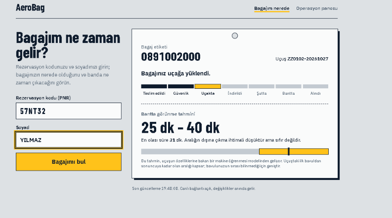
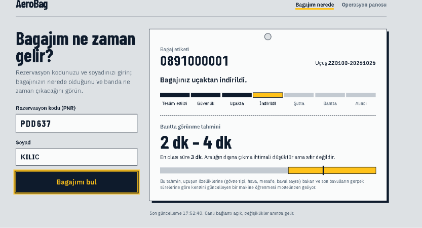
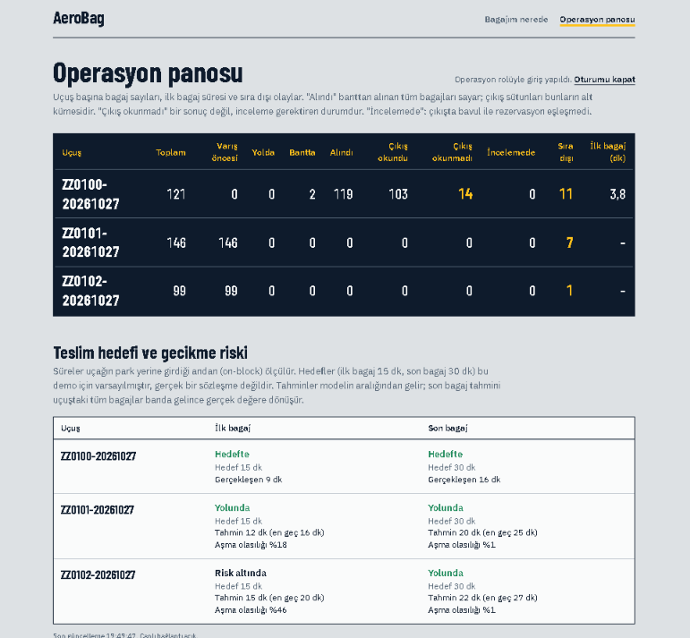
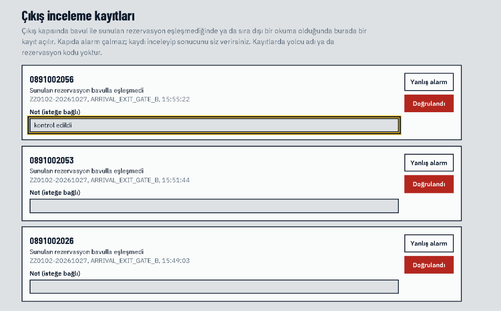
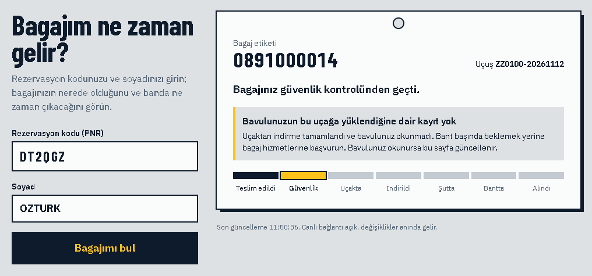
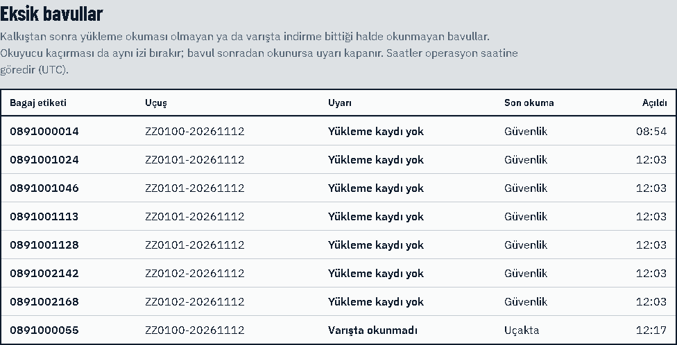
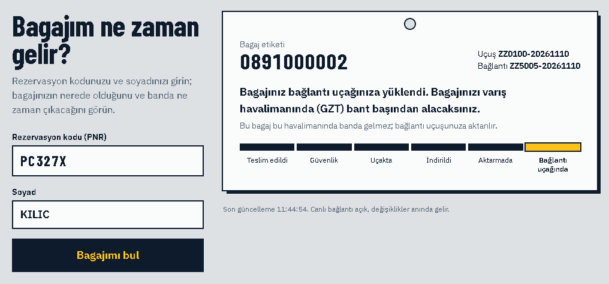
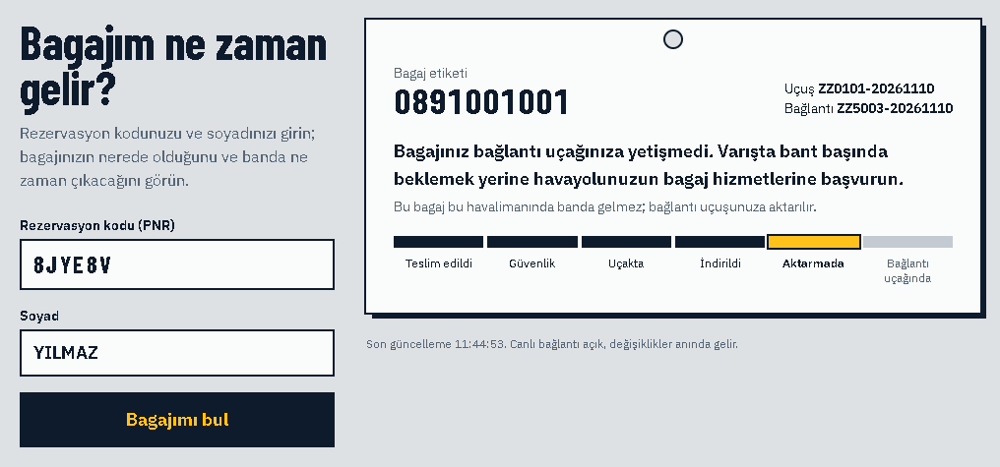
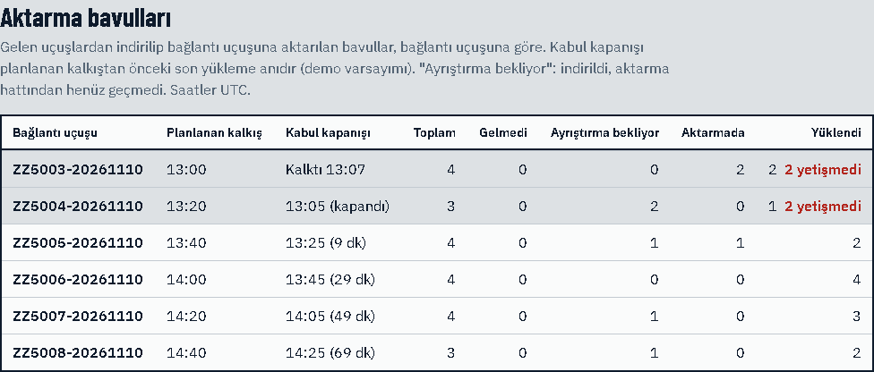
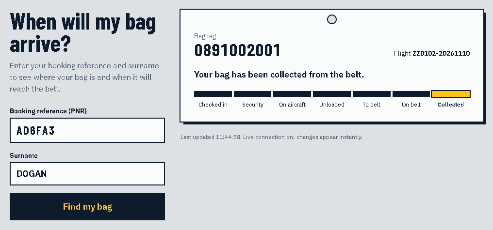

# AeroBag

[Türkçe](README.md) | **English**


A single-station module for an **airline's baggage tracking system**. It follows a bag from check-in to the carousel or to the connecting aircraft, and answers three questions:

1. **Did this bag make it onto the aircraft?** A bag that was not loaded, or not unloaded on arrival, raises an alert for staff and for the passenger. The alert rule was measured against reader misses.
2. **Will a transfer bag make its connection?** The bag's records on the inbound and onward flights are linked. Bags that miss the acceptance cut-off appear on the staff board; bags that miss the connection appear on the passenger's card.
3. **When will the passenger get the bag?** A **prediction interval** instead of a single time, plus first/last bag delivery targets and delay risk for the station.

Why the airline: when a bag goes missing, the airline is the party the passenger turns to and the one held responsible; the passenger data (PNR) lives in its systems; and IATA Resolution 753 asks airlines to track baggage. In this design the ground handler and the airport are data providers. Bag-to-PNR matching at the exit gate (ExitGuard) is included as an **optional** module an airport could deploy.

> **This is a portfolio project, not a product.** All data comes from a simulator; no real airport, airline or passenger data is used, and no IATA compliance is claimed. Results and their limits are in [docs/EVALUATION.md](docs/EVALUATION.md); everything that was not measured or not built is listed in [docs/IMPLEMENTATION_STATUS.md](docs/IMPLEMENTATION_STATUS.md).

The detailed documents under `docs/` and the staff screens are in Turkish. The passenger page is available in Turkish and English.

| Passenger: before unloading (flight-level ML interval) | Passenger: after unloading (bag-level ML) |
|---|---|
|  |  |
| **Operations board and delivery target risk** | **Security screen: exit review records** |
|  |  |
| **Passenger: no record that the bag was loaded** | **Operations: missing bags** |
|  |  |
| **Passenger: transfer bag on the connecting aircraft** | **Passenger: bag missed the connection** |
|  |  |
| **Operations: transfer bags and acceptance cut-off** | **Passenger page in English** |
|  |  |

## Highlights

**The missing-bag alert was measured together with reader misses.** "Not loaded" and "not unloaded on arrival" are alerts, not bag states; if the bag is read later, the alert closes as "found". In the simulation every bag that was not loaded reaches the staff screen before the aircraft lands. In the first measurement about 4 in 5 of these alerts were false, caused by a missed loading read, so the passenger is only told on arrival. Result: false alerts shown to passengers fell from 15.5 to 1.8 per 1000 bags, and in 89% of real cases the passenger is told before the carousel empties.

**It can say "I don't know" where there is no reader.** Many stations have no reader at the carousel entry or at collection. Read coverage is given by configuration (`full`, `typical`, `minimal`); the system does not treat skipping those points as an anomaly, bases the SLA on times reported by the ground handler, and tells the passenger "most likely on the belt". In a `typical` setup, a rule that ignores coverage would flag about 1058 anomalies per 1000 bags (practically every bag); the coverage-aware rule flags about 58, the reads that were genuinely lost.

**Interval prediction, measured against a baseline.** For the time from unloading to the belt, a quantile LightGBM model reduces the P50 error of the empirical method from 1.60 to 0.72 minutes in the same regime, narrows the interval from 5.0 to 2.2 minutes, and keeps coverage on target (79%). On a rainy, slow day (regime shift) the model is overconfident (coverage 45%). A live correction fed by the actual times of completed bags brings coverage back to 77% and P50 error to 1.0 minute. Negative results, such as bag-specific features adding nothing, are in the report too.

**The security design is mapped to a threat model and to tests.**
- **Authentication:** staff sign in with short-lived JWTs and roles. A passenger token only sees that passenger's own bags.
- **Signed sources:** message sources are HMAC-signed (timestamp, nonce, body digest).
- **Append-only log:** the database role has no delete permission on any table, and the event log is append-only.
- **Personal data:** name, surname and PNR are never stored in plain text; when the retention period ends, the lookup digests are irreversibly replaced.
- **No demo defaults outside development:** the API refuses to start with the demo passwords and keys in this repository unless it runs in the development environment.
- **Issues found:** two privacy leaks (name and PNR exposed in raw messages and server logs) were found during development, fixed and documented. A code review on 10 November 2026 closed four more gaps (see the changelog).
- Which test verifies each control is listed in [docs/THREAT_MODEL.md](docs/THREAT_MODEL.md).

**Resilient event processing.**
- **State machine:** Type B messages (BSM, BUM, BPM) are parsed with strict limits and run through a monotonic state machine.
- **Message safety:** duplicates are deduplicated, out-of-order messages never move a bag backwards, malformed messages go to a dead-letter table.
- **Live updates:** changes reach the browser through a transactional outbox and SignalR. Notifications carry no content.

**Optional module: exit verification (ExitGuard), measured together with its false alarm cost.** The bag read at the gate is compared with the digest of the PNR presented. Passengers on the same booking may take each other's bags; a mismatch creates a silent review record instead of an alarm at the gate. In a 27,000-bag simulation with the default sensor error assumptions, 87% of cases were caught and none passed as the owner. 1.38% of legitimate reads became false alarms. Because real cases are rare, only about 24% of opened reviews are genuine (base-rate effect), which is why human review was chosen over a gate alarm.

**416 .NET tests**: unit tests and integration tests running on a real PostgreSQL through Testcontainers, plus Python tests for the ML side. All of them run in GitHub Actions on every push.

## Architecture

```
 Simulator (Type B, flight context, gate packets) ──HMAC signed──┐
                                                                 ▼
 Passenger page ──PNR+surname──▶  ASP.NET Core API  ──restricted role──▶ PostgreSQL
 Operations / security ──JWT──▶   (state machine,                  (append-only event log,
                                   ExitGuard, SLA)                   bag state, outbox, gate reads)
          ▲                          │      │
          └── SignalR (no content) ◀─┘      └──HTTP──▶ ML service (FastAPI, quantile LightGBM, live correction)
```

| Layer | Technology |
|---|---|
| API and business logic | .NET 10, ASP.NET Core minimal API, SignalR |
| Data | PostgreSQL 16 (Npgsql), transactional outbox |
| Machine learning | Python 3.12, LightGBM (quantile regression), FastAPI |
| Frontend | React, TypeScript, Tailwind, Vite |
| Tests and CI | xUnit, Testcontainers, pytest, GitHub Actions |

The detailed design is in [docs/ARCHITECTURE.md](docs/ARCHITECTURE.md) (Turkish).

## Running it

Requirements: .NET 10 SDK, Docker Desktop, Node 20+.

**One command (Windows):**

```powershell
scripts\demo              # starts Postgres + ML, migrations, API, frontend, simulator (separate windows), browser
scripts\demo -Stop        # stops everything and leaves no process behind (data is kept)
```

The script first checks the Docker engine, available memory and ports 5080/5173, then starts the services in order and waits for each to be ready. Options: `-Coverage typical|minimal`, `-Speed`, `-Seed`, `-NoSimulator`, `-NoBuild` (details: `Get-Help scripts\demo.ps1 -Detailed`). Use `-Seed 1` to get a bag that is not loaded on the first flight.

**Manually, step by step:**

```powershell
docker compose up -d --build                                          # PostgreSQL (127.0.0.1:5433) + ML service (127.0.0.1:8000)
dotnet run --project src\AeroBag.Core\AeroBag.Migrator                # creates / updates the schema (db/migrations)
dotnet run --project src\AeroBag.Core\AeroBag.Api --urls http://localhost:5080
cd src\aerobag-ui; npm install; npm run dev                           # separate terminal: http://localhost:5173
dotnet run --project src\AeroBag.Core\AeroBag.Simulator -- --mode live --speed 5   # separate terminal
```

- **Passenger page:** the simulator prints sample PNRs and surnames when it starts; use them on the passenger page.
- **Operations board:** requires sign-in. The demo users are for the local demo only: `ops` / `ops-demo-2026` and `security` / `security-demo-2026`. The security role shows the exit review records.
- **Evaluation modes** (no API needed): `--mode gate-eval` (ExitGuard false alarm and catch rates), `--mode alert-eval` (missing-bag alert catch rate, detection delay and false alerts by grace period), `--mode coverage-eval` (passenger notification delay, SLA source and anomaly counts across `full`, `typical`, `minimal`).
- **Load test:** with the API running in Release mode, `dotnet run -c Release --project src\AeroBag.Core\AeroBag.Simulator -- --mode load` sends signed messages concurrently and reports messages per second and latency percentiles. Run it on a clean database.
- **Read coverage:** by default a reader is assumed at every point. To try a common setup with no reader at the carousel entry or at collection, start the API with `$env:Coverage__Profile="typical"` and the simulator with `--coverage typical` (`minimal`: loading and unloading only). Both must use the same profile.
- **Transfer bags:** in live mode about 6% of bags are transfer bags (`--transfer-rate`, a demo assumption): they go to a connecting flight departing from this station (ZZ5xxx) instead of the carousel.
- **When the schema changes:** run the migrator again; data is kept. The API does not start if the database is not at the schema version the code expects, and tells you what to do.

The passwords and keys in this repository are for the local demo only: outside the development environment (`ASPNETCORE_ENVIRONMENT` other than `Development`) the API refuses to start with them; `dotnet run` selects the development environment locally. The keys a real deployment must provide (`Auth__Users__*`, `Auth__SigningKey`, `Ingest__Sources__*`, `Security__LookupKeySecret`, `ConnectionStrings__Default`) and all simulator options (`--help`) are described in [docs/IMPLEMENTATION_STATUS.md](docs/IMPLEMENTATION_STATUS.md).

## Tests

```powershell
dotnet test                              # Docker must be running (integration tests start a real PostgreSQL)
cd ml; python -m pytest -q tests         # Python 3.12, ml/requirements.txt
```

## Documents

All documents below are in Turkish.

| Document | Contents |
|---|---|
| [ARCHITECTURE.md](docs/ARCHITECTURE.md) | Target design: phases, data flow, state machine, contracts |
| [IMPLEMENTATION_STATUS.md](docs/IMPLEMENTATION_STATUS.md) | Current state of the code, deviations from the design, known gaps, configuration |
| [CHANGELOG.md](docs/CHANGELOG.md) | What each work package did, its limits and tests (newest first) |
| [EVALUATION.md](docs/EVALUATION.md) | ML and ExitGuard measurements, negative results, simulator compared with public references |
| [THREAT_MODEL.md](docs/THREAT_MODEL.md) | STRIDE: control, test and open items for each threat |
| [KVKK.md](docs/KVKK.md) | Where personal data goes, retention (Turkish data protection law; not legal advice) |
| [DEMO.md](docs/DEMO.md) | 7–8 minute demo flow: preparation, what to show on which screen, frequent questions |
| [OZET.md](docs/OZET.md) | One-page summary |
| [GERCEK_VERI_PLANI.md](docs/GERCEK_VERI_PLANI.md) | Real-data plan: what would be measured, which data would be requested, stages |

## Project layout

| Folder | Contents |
|---|---|
| `src/AeroBag.Core/AeroBag.Domain` | State machine (pure, no side effects) |
| `src/AeroBag.Core/AeroBag.Application` | Type B parser and redaction, ETA and SLA calculation, ExitGuard rule, request signature |
| `src/AeroBag.Core/AeroBag.Infrastructure` | PostgreSQL access, event processing, gate service, queries, outbox, retention |
| `src/AeroBag.Core/AeroBag.Api` | Minimal API, authentication, signature verification, SignalR, background jobs |
| `src/AeroBag.Core/AeroBag.Simulator` | Seeded baggage flow and gate sensor model, evaluation modes |
| `src/aerobag-ui` | Passenger page (Turkish/English), operations board, security screen |
| `ml` | Data, models, evaluation and the FastAPI prediction service |
| `contracts/ml` | Request/response contract between the API and the ML service (both sides are tested against it) |
| `tests` | Unit and integration tests |
| `db/migrations` | Schema migrations applied in order (schema, application role, grants) |
| `src/AeroBag.Core/AeroBag.Migrator` | Migration tool (runs with the table owner account) |

## Limits

- **Single station:** this version is one airline's view of a single station. Extending it to a network (hub and stations, read coverage per station, the arrival side of a transfer bag) would follow feedback from the industry.
- **Simulation:** every result comes from a simulator. The model and the simulator share the same generating assumptions, so results may be optimistic. The simulator was compared with public references for order of magnitude only; it was not calibrated.
- **ExitGuard rates:** depend on sensor assumptions I chose; they were not measured in the field.
- **Local setup:** TLS, a key vault, key rotation and multi-instance deployment are out of scope. The keys and passwords in the repository are development defaults.
- **Flight context:** aircraft type, weather and distances come from the simulator, not from a real flight information system.
- **Integration:** messages are a simplified Type B over HTTP; there is no connection to SITA messaging, DCS, BRS, AODB or WorldTracer.
- **Phase 5:** the RFID exit gate hardware demo is optional and was not built.

## Licence

All rights reserved. The repository is published to be read and evaluated: you may inspect the code and run it on your own machine for evaluation. Using it in production, modifying it, distributing it or creating derivative works requires the author's written permission. Details: [LICENSE](LICENSE).
