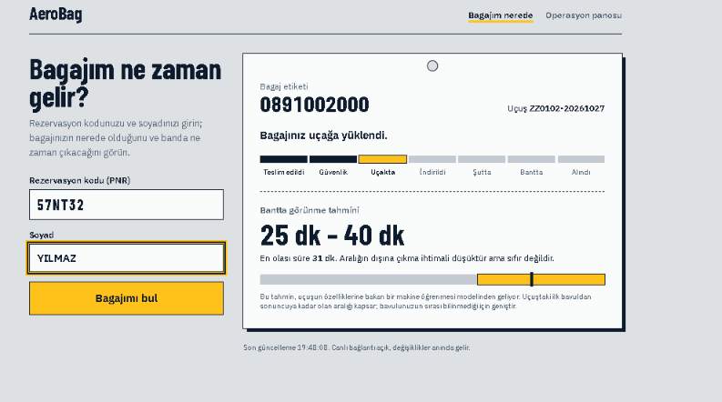
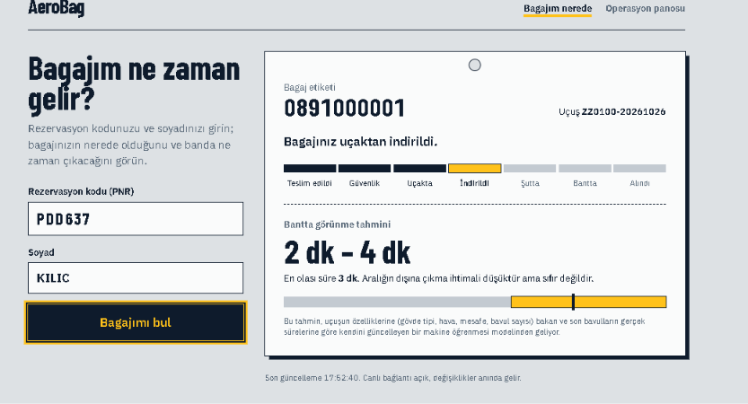
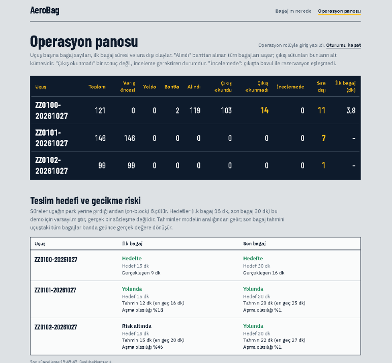
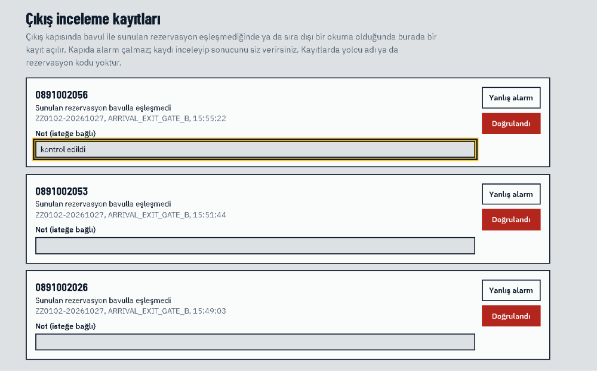

# AeroBag


Havalimanında bavulun yolculuğunu uçtan uca izleyen bir mühendislik projesi. Yolcuya "bavulum ne zaman gelir?" sorusunun cevabını tek bir saat yerine bir **tahmin aralığı** olarak verir. Operasyon ekibine teslim hedefi ve gecikme riski panosu sunar. Çıkış kapısında bavulun doğru kişiyle çıkıp çıkmadığını yanlış alarm üretmeden kontrol etmeye çalışır.

> **Bu bir ürün değil, bir portfolyo projesidir.** Bütün veri simülasyondan gelir; gerçek havalimanı, havayolu ya da yolcu verisi kullanılmaz ve IATA uyumluluğu iddia edilmez. Sonuçlar ve sınırları [docs/EVALUATION.md](docs/EVALUATION.md)'de, ölçülmeyen ya da yapılmayan her şey [docs/IMPLEMENTATION_STATUS.md](docs/IMPLEMENTATION_STATUS.md)'de açıkça yazılıdır.

| Yolcu: indirme öncesi (uçuş düzeyi ML aralığı) | Yolcu: indirildikten sonra (bavul düzeyi ML) |
|---|---|
|  |  |
| **Operasyon panosu ve teslim hedefi riski** | **Güvenlik ekranı: çıkış inceleme kayıtları** |
|  |  |

## Öne çıkanlar

**Aralık tahmini, taban çizgisine karşı ölçüldü.** İndirmeden banta kalan süre için kuantil LightGBM, aynı rejimde ampirik yöntemin P50 hatasını 1,60 dakikadan 0,72 dakikaya indirir, aralığı 5,0 dakikadan 2,2 dakikaya daraltır ve kapsamayı hedefte (%79) tutar. Yağmurlu ve yavaş bir güne (rejim kayması) geçince model fazla emin kalır (kapsama %45). Biten bavulların gerçek sürelerinden beslenen canlı düzeltme kapsamayı %77'ye, P50 hatasını 1,0 dakikaya getirir. Bavula özgü özelliklerin katkı sağlamadığı gibi olumsuz sonuçlar da raporda.

**Çıkış doğrulama (ExitGuard) yanlış alarm maliyetiyle birlikte ölçüldü.** Kapıda okunan bavul ile sunulan PNR'ın özeti karşılaştırılır. Aynı rezervasyondaki yolcular birbirinin bavulunu alabilir, uyuşmazlık kapıda alarm değil sessiz bir inceleme kaydı üretir. Varsayılan sensör hatalarıyla yapılan 27.000 bavulluk simülasyonda vakaların %87'si yakalandı ve hiçbiri sahip diye geçmedi. Meşru okumaların %1,38'i yanlış alarma dönüştü. Vaka çok nadir olduğu için açılan incelemelerin yalnızca yaklaşık %24'ü gerçek (taban oran etkisi). Kapıda alarm yerine insan incelemesi seçilmesinin gerekçesi bu.

**Güvenlik tasarımı tehdit modeliyle ve testlerle eşleştirildi.**
- **Kimlik doğrulama:** personel kısa ömürlü JWT ve rollerle giriyor. Yolcu jetonu yalnızca kendi bavullarını görüyor.
- **İmzalı kaynaklar:** mesaj kaynakları HMAC imzalı (zaman damgası, tek kullanımlık değer, gövde özeti).
- **Değiştirilemez günlük:** veritabanı rolünde hiçbir tabloda silme yetkisi yok, olay günlüğü yalnızca eklemeli.
- **Kişisel veri:** ad, soyad ve PNR hiçbir yerde düz metin saklanmıyor, saklama süresi dolunca arama özetleri de geri dönülmez şekilde siliniyor.
- **Bulunan açıklar:** geliştirme sırasında iki gizlilik açığı (ham mesajda ve sunucu kayıtlarında açıkta kalan ad ve PNR) bulundu, düzeltildi ve belgelendi.
- Her önlemin hangi testle doğrulandığı [docs/THREAT_MODEL.md](docs/THREAT_MODEL.md)'de.

**Dayanıklı olay işleme.**
- **Durum makinesi:** Type B mesajları (BSM, BUM, BPM) sıkı sınırlarla ayrıştırılıp monoton bir durum makinesinden geçirilir.
- **Mesaj güvenliği:** çift gelen mesajlar tekilleştirilir, sırasız mesajlar durumu geri almaz, bozuk mesajlar ölü mektup tablosuna gider.
- **Canlı bildirim:** değişiklikler transactional outbox ile SignalR'a iletilir. Bildirimler içeriksizdir.

**225 .NET testi**, birim testleri ve Testcontainers ile gerçek PostgreSQL üzerinde çalışan entegrasyon testleri. Bunlara ek olarak ML tarafı için Python testleri var. Hepsi her `push`'ta GitHub Actions'ta çalışır.

## Mimari

```
 Simülatör (Type B, uçuş bağlamı, kapı paketleri) ──HMAC imzalı──┐
                                                                 ▼
 Yolcu sayfası ──PNR+soyad──▶  ASP.NET Core API  ──kısıtlı rol──▶ PostgreSQL
 Operasyon / güvenlik ──JWT──▶  (durum makinesi,              (olay günlüğü yalnızca eklemeli,
                                 ExitGuard, SLA)                bavul durumu, outbox, kapı okumaları)
          ▲                          │      │
          └── SignalR (içeriksiz) ◀──┘      └──HTTP──▶ ML servisi (FastAPI, kuantil LightGBM, canlı düzeltme)
```

| Katman | Teknoloji |
|---|---|
| API ve iş mantığı | .NET 10, ASP.NET Core minimal API, SignalR |
| Veri | PostgreSQL 16 (Npgsql), transactional outbox |
| Makine öğrenmesi | Python 3.12, LightGBM (kuantil regresyon), FastAPI |
| Arayüz | React, TypeScript, Tailwind, Vite |
| Test ve CI | xUnit, Testcontainers, pytest, GitHub Actions |

Ayrıntılı tasarım [docs/ARCHITECTURE.md](docs/ARCHITECTURE.md)'de.

## Çalıştırma

Gereksinimler: .NET 10 SDK, Docker Desktop, Node 20+.

```powershell
docker compose up -d --build                                          # PostgreSQL (5433) + ML servisi (127.0.0.1:8000)
dotnet run --project src\AeroBag.Core\AeroBag.Api --urls http://localhost:5080
cd src\aerobag-ui; npm install; npm run dev                           # ayrı terminal: http://localhost:5173
dotnet run --project src\AeroBag.Core\AeroBag.Simulator -- --mode live --speed 5   # ayrı terminal
```

- **Yolcu sayfası:** simülatör başlangıçta örnek PNR ve soyadları yazdırır, bunlarla yolcu sayfasında sorgu yapılır.
- **Operasyon panosu:** giriş ister. Demo kullanıcıları yalnızca yerel demo içindir: `ops` / `ops-demo-2026` ve `security` / `security-demo-2026`. Güvenlik rolüyle girince çıkış inceleme kayıtları görünür.
- **ExitGuard değerlendirmesi:** `dotnet run --project src\AeroBag.Core\AeroBag.Simulator -- --mode gate-eval` komutu kuralın sinyal eşiğine göre yanlış alarm ve yakalama oranlarını API'siz hesaplar.
- **Şema değişince:** `docker compose down -v` ile veritabanı sıfırlanır.

Gerçek bir kurulumda verilmesi gereken anahtarlar (`Auth__SigningKey`, `Ingest__Sources__*`, `Security__LookupKeySecret`, `ConnectionStrings__Default`) ve simülatörün bütün seçenekleri (`--help`) için [docs/IMPLEMENTATION_STATUS.md](docs/IMPLEMENTATION_STATUS.md)'ye bakın.

## Testler

```powershell
dotnet test                              # Docker açık olmalı (entegrasyon testleri gerçek PostgreSQL başlatır)
cd ml; python -m pytest -q tests         # Python 3.12, ml/requirements.txt
```

## Belgeler

| Belge | İçerik |
|---|---|
| [ARCHITECTURE.md](docs/ARCHITECTURE.md) | Hedef tasarım: fazlar, veri akışı, durum makinesi, sözleşmeler |
| [IMPLEMENTATION_STATUS.md](docs/IMPLEMENTATION_STATUS.md) | Kodun şu anki durumu, tasarımdan sapmalar, bilinen eksikler |
| [EVALUATION.md](docs/EVALUATION.md) | ML ve ExitGuard ölçümleri, olumsuz sonuçlar, simülatörün kamuya açık referanslarla karşılaştırması |
| [THREAT_MODEL.md](docs/THREAT_MODEL.md) | STRIDE: her tehdit için önlem, test ve açık kalanlar |
| [KVKK.md](docs/KVKK.md) | Kişisel verinin nereye gittiği, saklama süresi (hukuki danışmanlık değildir) |

## Proje yapısı

| Klasör | İçerik |
|---|---|
| `src/AeroBag.Core/AeroBag.Domain` | Durum makinesi (saf, yan etkisiz) |
| `src/AeroBag.Core/AeroBag.Application` | Type B ayrıştırıcı ve maskeleme, ETA ve SLA hesabı, ExitGuard kuralı, istek imzası |
| `src/AeroBag.Core/AeroBag.Infrastructure` | PostgreSQL erişimi, olay işleme, kapı servisi, sorgular, outbox, saklama süresi |
| `src/AeroBag.Core/AeroBag.Api` | Minimal API, kimlik doğrulama, imza doğrulama, SignalR, arka plan işleri |
| `src/AeroBag.Core/AeroBag.Simulator` | Tohumlu bavul akışı ve kapı sensörü modeli, ExitGuard değerlendirmesi |
| `src/aerobag-ui` | Yolcu sayfası, operasyon panosu, güvenlik ekranı |
| `ml` | Veri, modeller, değerlendirme ve FastAPI tahmin servisi |
| `tests` | Birim ve entegrasyon testleri |
| `db/init.sql` | Şema, uygulama rolü ve yetkiler |

## Sınırlar

- **Simülasyon:** sonuçların hepsi simülasyondan geliyor. Model ile simülatör aynı üretici ailesinden olduğu için sonuçlar iyimser olabilir. Simülatör kamuya açık referanslarla yalnızca büyüklük mertebesi olarak karşılaştırıldı, kalibre edilmedi.
- **ExitGuard oranları:** benim koyduğum sensör varsayımlarına bağlı, sahada ölçülmedi.
- **Yerel kurulum:** TLS, anahtar kasası, anahtar döndürme ve çok örnekli kurulum kapsam dışı. Depodaki anahtarlar ve parolalar geliştirme varsayılanlarıdır.
- **Uçuş bağlamı:** gövde tipi, hava ve mesafeler gibi bilgiler gerçek bir uçuş bilgi sisteminden değil, simülatörden geliyor.
- **Faz 5:** RFID çıkış kapısı donanım demosu isteğe bağlıdır ve yapılmadı.
